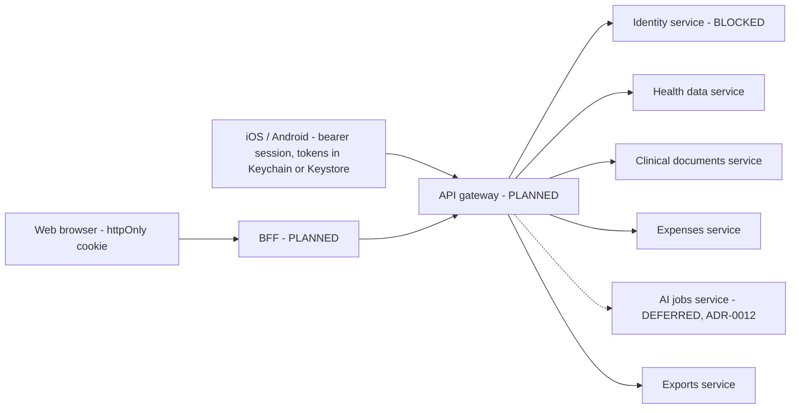

# API contracts (contract level)

**Status:** Draft, **PLANNED**. No backend exists or is deployed. **Last updated:** 2026-10-17.

This describes the *shape and rules* of future services in terms of the existing JSON Schema (`packages/contracts/schemas/portal.json`). It deliberately defines **no hostnames, base URLs, My Number/IdP endpoints, OIDC scopes, client IDs, certificate flows, object-storage URLs or scanner vendors**. Resource paths below are **illustrative names** for review only and are not committed routes; the real transport contract will live in `packages/api` after owner approval of S11.

Anything involving the IdP is **BLOCKED / UNCONFIRMED**.

Related: [data-model.md](data-model.md) · [system-architecture.md](system-architecture.md) · [threat-model](../security/threat-model.md)

## 1. Principles

- Server-side authorization, consent and purpose checks on every sensitive operation; clients are never the enforcement point (`packages/api/README.md`).
- Minimum data per screen. No bulk "dump" endpoints.
- Identity key is `pairwiseSub`; the individual number never appears in any request/response/log.
- Base URL comes from configuration (`HEALTH_APP_API_BASE_URL`, no value in git).
- Clients validate every response against the schema and tolerate unknown enum values.
- Web clients call only the BFF same-origin; browser JavaScript never receives access/refresh tokens.

## 2. Client-to-service model



How native clients authenticate to the API (bearer vs. other) depends on the IdP/session design and is **UNCONFIRMED**.

## 3. Services and operations

Operation names are descriptive. "Schema" refers to portal.json objects or a **PLANNED** schema.

| Service | Operation (illustrative) | Request | Response | Schema | Status |
|---|---|---|---|---|---|
| Identity | Begin sign-in / complete sign-in / end session | Per official IdP - UNCONFIRMED | Session + `identity` | `identity` | **BLOCKED** |
| Identity | Read current identity | none | `identity` | `identity` | **BLOCKED** |
| Web auth (fallback) | Passkey register/authenticate; email OTP request/verify | WebAuthn ceremony payloads; email + code | server session, `authMethod` | PLANNED schema | PLANNED per [ADR-0010](../adr/0010-web-auth-strategy.md); **not My Number identity**; only used if the official IdP web flow is unavailable or not free |
| Health data | Get wellness sync state | none | `wellnessSync` | `wellnessSync` | PLANNED |
| Health data | Submit measurements (scopes `steps`, `heartRate` first) | batch of measurements + purposeId | acknowledgment | PLANNED schema | PLANNED; needs consent |
| Health data | Delete measurements | scope/time range | acknowledgment | PLANNED | PLANNED |
| Clinical | Create upload session (**web and native, MVP**) | `declaredType`, `byteSize`, document id | short-lived, single-document, single-use upload authorization (opaque; no public URL) | PLANNED | PLANNED; fail closed behind NotConfigured until security review. Server enforces type allowlist and size limit, never trusts the declared values |
| Clinical | Finalize upload | document id | stage `quarantined`; scan result arrives asynchronously | PLANNED | PLANNED; file is unreadable by the user-facing API until scan passes |
| Clinical | Download/view own document | document id | authenticated stream through the BFF, `Cache-Control: private, no-store`, `Content-Disposition` attachment, `nosniff`; or short-lived signed URL | PLANNED | PLANNED; never a permanent URL
| Clinical | Get document status | document id | stage/status (`ClinicalPipelineStage`) | PLANNED | PLANNED |
| Clinical | Confirm review / delete document | document id | acknowledgment | PLANNED | PLANNED |
| Expenses | Get expense summary for tax year | `taxYear` | `medicalExpenses` | `medicalExpenses` | PLANNED |
| Expenses | Put/get lines, evaluate | lines (as `ExpenseLine`) | `EligibilityResult` fields | PLANNED | PLANNED |
| Exports | Create preview / confirm export | taxYear + explicit user confirmation | preview, then artifact handle | PLANNED | PLANNED; legal TBD |
| AI | Request insight job / get result | record references | text + sources + timestamps + uncertainty | DEFERRED | **DEFERRED to post-MVP** ([ADR-0012](../adr/0012-ai-deferred.md)); no endpoint in MVP |
| Consent | Record / read decision | category, decision, purposeId | acknowledgment | PLANNED | PLANNED |

Aggregate "portal" read: the existing `portal.json` is one object combining `identity`, `wellnessSync`, `medicalExpenses`. Whether that is served as one endpoint or composed by the BFF is **undecided**.

## 4. Example payloads (synthetic)

Valid against the live schema:

```json
{
  "identity": { "pairwiseSub": "SYNTH-SUB-0001", "verifiedAt": "2026-01-01T00:00:00Z" },
  "wellnessSync": { "platform": "ios_healthkit", "status": "not_connected", "lastSyncedAt": null },
  "medicalExpenses": { "taxYear": 2024, "eligibleAmountJpy": 12000, "calculationStatus": "ready_for_export" }
}
```

(`12000` matches the synthetic fixture `SYNTH-CASE-documented-consultation`; it is not tax advice.)

## 5. Error model (proposed)

One envelope for all services; **never** includes personal data, tokens, filenames or payload echoes.

```json
{
  "error": {
    "code": "consent_required",
    "message": "Human-safe, non-sensitive summary",
    "requestId": "opaque-correlation-id",
    "retryable": false
  }
}
```

| HTTP | `code` | Meaning |
|---|---|---|
| 400 | `invalid_request` | Schema validation failed |
| 401 | `unauthenticated` | No/expired session |
| 403 | `forbidden` / `consent_required` / `purpose_mismatch` | Authorization, consent or purpose check failed |
| 404 | `not_found` | Also returned for resources the caller may not know exist |
| 409 | `conflict` | State conflict (for example document already in review) |
| 413 / 415 | `too_large` / `unsupported_type` | Upload limits |
| 422 | `quarantined` / `validation_failed` | File failed validation |
| 429 | `rate_limited` | With retry hint |
| 503 | `unavailable` | Capability/service down; maps to client `unavailable` |

Client mapping: transport/`unavailable` → `CapabilityStatus.unavailable`; no wired adapter → `notConfigured` (today's only state). Codes are a proposal pending owner/CoE review.

## 6. Versioning and compatibility

- Contract version is in the schema `$id` path (currently `.../schemas/portal.json`); a breaking change adds a new versioned file (for example `portal.v2.json`) rather than mutating; both live until clients migrate.
- Additive changes only within a version: new optional fields, new enum values (clients must tolerate unknown values).
- Every change ships with synthetic fixtures and a compatibility note; CI already parses all JSON under `packages/contracts` and `packages/domain`.
- Planned: schema-validation tests in each client, and generated TypeScript types for `apps/web`.
- API version negotiation (header vs path) is **undecided**.

## 7. Security requirements for every endpoint

AuthN via validated session; per-user authorization; consent + purpose check; input validation; rate limiting; audit event (no payload); idempotency for uploads/exports; CSRF protection for cookie-authenticated web requests (SameSite + token/Origin checks); strict CORS (BFF same-origin only).

## 8. Explicitly not defined here

IdP issuer/endpoints/scopes/claims, client IDs, redirect URIs, card/NFC protocol steps, object-storage locations, scanner vendors, production hostnames. Fill only from official documentation and approved registration.

## 9. Clinical upload contract rules (web and native)

1. Create-session call validates the declared type against a server allowlist (list TBD: SPEC Q4) and the size limit; the server re-checks actual bytes and sniffs content type; a mismatch rejects with `unsupported_type` / `too_large`.
2. Uploads go to a **private** object store; the authorization is bound to account id, document id, size and expiry (minutes), single use. No public URL exists at any stage.
3. After upload the object is **quarantined**; a malware scan (vendor TBD) runs before any other service can read it; failures are deleted and the user sees a generic failure.
4. Filenames are never trusted or logged; storage keys are random.
5. Rate limits per account; idempotency key on create/finalize.
6. Web uploads go through the BFF (same-origin, CSRF-protected) or via a signed URL obtained from it; browser code never holds storage credentials.
7. While the pipeline adapter is `NotConfigured`, every call above returns `not_configured` and no object is created.
