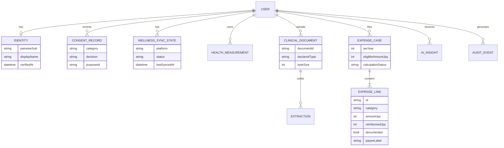

# Data model

**Status:** Draft. **Last updated:** 2026-10-17.
Derived from `packages/contracts/schemas/portal.json` (live), `packages/domain/eligibility.py`, the privacy baseline categories, and the clinical/wellness baselines. Anything not in those sources is labeled **PLANNED** and is a proposal for review, not a decision. No real data; fixtures are synthetic.

Related: [system-architecture.md](system-architecture.md) · [api-contracts.md](api-contracts.md) · [privacy-baseline.md](../privacy-baseline.md) · [threat-model](../security/threat-model.md)

## 1. Live contract (`portal.json`, JSON Schema 2020-12)

Top-level object, `additionalProperties: false`, all three properties required.

| Property | Field | Type / constraint | Required |
|---|---|---|---|
| `identity` | `pairwiseSub` | string, minLength 1 | yes |
| | `displayName` | string | no |
| | `verifiedAt` | string, date-time | yes |
| `wellnessSync` | `platform` | enum `ios_healthkit`, `android_health_connect` | yes |
| | `status` | enum `not_connected`, `connected`, `permission_denied`, `error` | yes |
| | `lastSyncedAt` | string date-time or null | yes |
| `medicalExpenses` | `taxYear` | integer ≥ 2000 | yes |
| | `eligibleAmountJpy` | integer ≥ 0 | yes |
| | `calculationStatus` | enum `not_available`, `review_required`, `ready_for_export` | yes |

**Gap — web:** `wellnessSync.platform` has no web value. Adding one (for example a manual/import source) is a contract change that needs a data-classification review and compatibility note per `packages/contracts/README.md`. It is **PLANNED**, not decided; do not add a value without that review.

Clients must handle unknown enum values safely (contracts README).

## 2. Entity overview

## 3. Entities

Status column: **CONTRACT** = in `portal.json`; **CODE** = defined in client/domain code; **PLANNED** = proposal only.

| Entity | Fields | Class (privacy-baseline) | Status |
|---|---|---|---|
| Identity | `pairwiseSub`, `displayName?`, `verifiedAt` | identityPairwise — extremely high | CONTRACT |
| Individual number | none modeled; **never** a client field, key, log or analytics value | individualNumber — extremely high | Deliberately absent; any path needs legal review |
| ConsentRecord | category, decision (`granted`/`denied`/`notRecorded`), purposeId; no payloads | per category | CODE (`ConsentStore`; stub) |
| WellnessSyncState | `platform`, `status`, `lastSyncedAt` | healthMeasurements — high | CONTRACT |
| HealthMeasurement | scope (`steps`, `heartRate` first), value, unit, interval, source | healthMeasurements — high | PLANNED; scopes in code, schema not yet |
| ClinicalDocument | `documentId`, `declaredType` (`pdf`, `image`), `byteSize`, stage, status | clinicalDocuments — very high | CODE (descriptor, metadata-only); no contract object yet |
| Extraction | text/fields derived from a document, provenance to document | clinicalDocuments — very high | PLANNED |
| ExpenseCase | `taxYear`, `eligibleAmountJpy`, `calculationStatus`, `reviewReasons`, `contributingLineIds` | expenses — high | CONTRACT (3 fields) + CODE (`EligibilityResult`) |
| ExpenseLine | `id`, `category`, `amountJpy`, `reimbursedJpy`, `documented`, `payeeLabel` | expenses — high | CODE (domain, synthetic) |
| AIInsight | text, source refs, timestamps, uncertainty, disclaimer flag | per source data | PLANNED |
| AuditEvent | actor, action, resource type, time; **no payloads** | telemetry-grade, non-PII | PLANNED |

Enumerations (CODE): `ReviewReason` = `undocumented`, `unknown_category`, `negative_amount`, `over_reimbursed`. Expense categories in the synthetic engine: eligible `consultation`, `prescription`, `inpatient`, `dental_treatment`; ineligible `otc_supplement`, `cosmetic`. These are **engineering placeholders, not Japanese tax-law guidance**; legal thresholds and official category mapping are TODO for product/tax counsel.

## 4. Data classification summary

| Category | Sensitivity | Logged? | Sent to analytics/crash? |
|---|---|---|---|
| identityPairwise | Extremely high | Never | Never |
| individualNumber | Extremely high | Never | Never |
| healthMeasurements | High | Event names only | Never |
| clinicalDocuments | Very high | Never (also filenames) | Never |
| expenses | High | Event names only | Never |
| telemetry | Low only if strictly non-PII | n/a | Policy denies all today |

## 5. Device vs backend partition

| Data | Device (native) | Browser (web) | Backend (PLANNED) |
|---|---|---|---|
| Tokens / session | Keychain / Keystore | **Not in browser JS**; httpOnly cookie only | BFF holds tokens; API validates |
| pairwiseSub | Platform-protected storage | Server session; shown only as needed | Postgres (Neon), keyed account id; app-level encrypted if sensitive |
| Individual number | Not persisted | Not persisted | **Not stored by default** (My Number Act review; ADR-0011). Any exception: isolated, envelope-encrypted, narrowly authorized, only if legally approved |
| Health measurements | Local cache scoped to purpose (after Wellness) | In-memory / not persisted client-side | Postgres metadata after consent; sensitive fields envelope-encrypted |
| Clinical documents | Local quarantine until upload | Transient in memory during upload; no persistent store | Private object storage (provisional Vercel Blob private, [ADR-0011](../adr/0011-hosting-vercel-neon.md)); quarantine prefix, then review; signed short-lived access only; web uploads included in MVP |
| Expense drafts | Local drafts | Server-held drafts; no localStorage | Postgres |
| Consent | Local record + server ledger | Server-side ledger | Postgres, append-only audit table |
| Telemetry | Not configured | Not configured | Non-PII only, after vendor review |

## 6. Retention and deletion (policy TODO)

Retention periods are **TODO for product/legal** — none are decided and none are invented here. Engineering requirements that hold regardless:

- User-invokable deletion for clinical documents, health metadata and expense data, covered by tests before release (`clinical-baseline.md`).
- Deletion must cover derived data (extractions, AI insights, caches, exports) and backups per a policy to be set.
- Audit events keep metadata only and outlive the data they describe only if legal sets that.
- Quarantined, rejected files are discarded promptly (period TBD).

## 7. Schema evolution rules

1. Any new sensitive field needs a data-classification review and a `docs/security.md` / this-file update before merge (contracts README).
2. Compatibility notes and **synthetic** fixtures accompany every contract change.
3. `additionalProperties: false` stays; add fields explicitly and version the schema `$id` path when breaking (see [api-contracts.md](api-contracts.md)).
4. Planned contract expansion order follows delivery stages: expenses detail → wellness measurements → clinical document status → AI insight. Identity expansion is blocked.
5. TypeScript types for web, and Swift/Kotlin models, are generated or validated against the schema (tooling PLANNED).

## 8. Postgres model, encryption and keys (PLANNED; ADR-0011)

Backend store is Vercel-managed Postgres (Neon). Logical tables (names illustrative, **no schema is implemented**): `accounts` (pairwise sub or fallback-auth account id), `webauthn_credentials` (public key, counter, no secrets), `sessions` (hashed session id, expiry, auth method), `otp_challenges` (hashed code, expiry, attempts; only if ADR-0010 option 3 is enabled), `consents` (append-only), `wellness_measurements`, `clinical_documents` (metadata, stage, storage key, scan result, retention), `expense_drafts`, `audit_events` (metadata only).

Rules:

- **Row-level ownership:** every query is scoped by the authenticated account id; cross-user access is covered by tests (IDOR).
- **Envelope encryption:** sensitive columns (free-text clinical notes, measurement values, expense narratives, document keys) are encrypted in the application with a per-record data key wrapped by a master key; provider at-rest encryption (AES-256) is a second layer, not the only one. Key rotation and re-wrap procedure TBD.
- **Master-key custody is an open decision** (external KMS vs platform secret), see [hosting-and-compliance §5](hosting-and-compliance.md). The earlier GCP KMS/CMEK plan is superseded.
- **Individual number:** never stored or logged.
- **Clinical files** live in private object storage under a random, non-guessable key stored in `clinical_documents`; the database never stores file bytes. Quarantine and accepted files use separate prefixes; deletion removes object, row and derived data; backups/PITR retain history for the plan window (7-30 days on paid plans, 6 hours on Free).
- **Migrations:** versioned SQL, reviewed, run from CI with a migration-only credential; production credentials never in Preview scope.
- **Fixtures:** synthetic only; Preview and local databases never receive production data or branches.
