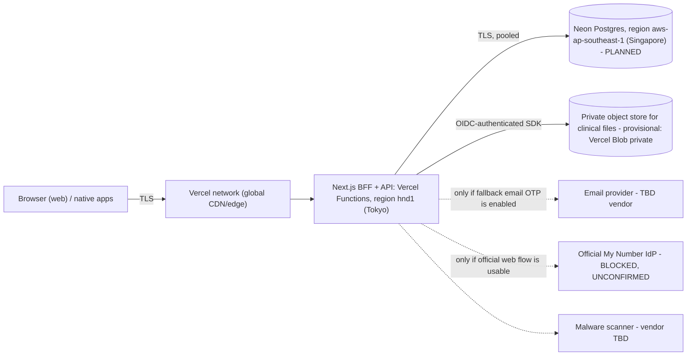

# Hosting, data residency, privacy and compliance (Vercel + Neon)

**Last updated:** 2026-10-17 · **Status:** Draft for legal and owner review · **Decision:** [ADR-0011](../adr/0011-hosting-vercel-neon.md)

This document records what could be **verified from official vendor documentation on 2026-10-17** (with URLs), what could not, and what needs legal review. It makes **no legal conclusions**. Vendor limits and prices change: re-verify before any production decision. Items tagged **UNVERIFIED** were not confirmed from an official source in this pass.

Nothing here is deployed. No project IDs, hostnames or connection strings exist or belong in the repo.

## 1. Target topology

Cross-border hops to review: browser to Vercel edge (global), `hnd1` functions to Singapore database, any scanner or email vendor.

## 2. Verified facts

### 2.1 Vercel

| Fact | Source |
|---|---|
| Tokyo is region `hnd1` (AWS ap-northeast-1); Osaka is `kix1` | https://vercel.com/docs/regions |
| Vercel Functions default to `iad1` (Washington, D.C.) for new projects; set `regions` (e.g. `["hnd1"]`) in project config or settings | https://vercel.com/docs/functions/configuring-functions/region |
| Static content is cached on the CDN and served from the region nearest the user, so the network is global even when functions are pinned | same page |
| Hobby plan is restricted to non-commercial personal use; commercial use needs Pro or Enterprise. "Commercial" includes any deployment used for financial gain of anyone involved, including a paid employee or consultant writing the code | https://vercel.com/docs/limits/fair-use-guidelines |
| Runtime logs retention: Hobby 1 hour, Pro 1 day, Pro + Observability Plus 30 days, Enterprise 3 days (30 with Observability Plus). Build logs are stored indefinitely per deployment | https://vercel.com/docs/logs/runtime , https://vercel.com/docs/limits |
| HIPAA BAA: not available on Hobby; Pro add-on listed at $350/month; Enterprise custom. Secure Compute is Enterprise only | https://vercel.com/pricing , https://vercel.com/docs/security/compliance |
| Data at rest encrypted with AES-256; in transit HTTPS/TLS 1.3 | https://vercel.com/docs/security/compliance |
| Certifications listed: SOC 2 Type 2, ISO 27001:2022, PCI DSS, EU-U.S. DPF, TISAX AL2 (none are Japan-specific) | https://vercel.com/pricing |
| Environment variables can be scoped to Production, Preview, Development and custom environments; "Secret" type variables are write-only after saving | https://vercel.com/docs/environment-variables , https://vercel.com/docs/environment-variables/sensitive-environment-variables |
| Deployment Protection (Vercel Authentication) is available for preview and production on Hobby; Password Protection is a paid add-on on Pro | https://vercel.com/docs/plans/hobby |
| Vercel Blob private stores require authentication for all reads and writes; objects get a non-public `*.private.blob.vercel-storage.com` URL; SDK uses short-lived OIDC tokens on Vercel; presigned GET URLs exist; recommended `Cache-Control: private, no-store` for sensitive data; avoid CDN caching of private blobs and avoid relying on middleware alone for auth | https://vercel.com/docs/vercel-blob/private-storage |

### 2.2 Neon

| Fact | Source |
|---|---|
| Documented regions: AWS us-east-1, us-east-2, us-west-2, eu-central-1, eu-west-2, **ap-southeast-1 (Singapore)**, ap-southeast-2 (Sydney), sa-east-1. **No Tokyo (ap-northeast-1) region is listed.** Region is fixed at project creation; moving needs a new project and migration. Availability may differ per organization: query the active-regions API with `org_id` | https://neon.com/docs/introduction/regions , https://api-docs.neon.tech/reference/getactiveregions |
| Free plan: $0, 100 projects, 10 branches/project, 100 CU-hours/project/month, up to 2 CU, 1 GB storage/project (20 GB account), 5 GB egress/project, compute scales to zero after 5 minutes (cannot be disabled), community support, 1 day monitoring history | https://neon.com/docs/introduction/plans , https://neon.com/faqs/free-plan-limits-and-quotas |
| When Free CU-hours or transfer run out, compute is suspended until next billing period or upgrade (data is not deleted) | https://neon.com/faqs/free-plan-limits-and-quotas |
| Instant restore / PITR window: Free 6 hours (capped at 1 GB of changes); Launch up to 7 days; Scale up to 30 days; history billed at $0.20/GB-month on paid plans; storage $0.35/GB-month | https://neon.com/docs/introduction/plans |
| SLA applies only to Business/Scale plans (99.95% compute-endpoint uptime threshold); **Free and Launch have no SLA** | https://neon.com/sla |
| Encryption: AES-256 at rest (keys in AWS KMS, managed by Neon); TLS 1.2+ required for connections | https://neon.com/docs/security/security-overview , https://neon.com/guides/hipaa-compliant-applications |
| HIPAA support is self-serve on the **Scale** plan after accepting a BAA with Databricks (Neon's parent); Free and Launch projects are not HIPAA compliant; customers must keep PHI out of metadata, names and logs | https://neon.com/docs/security/hipaa , https://neon.com/guides/hipaa-compliant-applications |
| Scale plan offers IP allowlist and Private Networking (AWS PrivateLink) | https://neon.com/docs/security/security-overview |
| Neon is available as a Vercel Marketplace integration (`vercel install neon`) that injects credentials as environment variables | https://vercel.com/marketplace/neon (search result summary; **UNVERIFIED in detail**) |

### 2.3 Not verified

- Vercel Blob Tokyo region availability, its exact region list, durability/SLA, and whether encryption keys are customer-managed (**UNVERIFIED**).
- Whether Vercel or Neon sign any Japan-specific data-processing terms, their sub-processor lists, and where support staff or backups are located (**UNVERIFIED**; read their DPAs and sub-processor pages).
- Customer-managed encryption keys (CMEK/BYOK) on Neon or Vercel: none were found in the pages above (**UNVERIFIED**; assume not available).
- Vercel Pro price details beyond the $350 BAA add-on and the Pro plan monthly base shown on the pricing page; current Neon Launch/Scale minimums; email provider prices.
- Behavior of Neon branching with respect to copying production data into previews (assume it copies data, hence the rule below).

## 3. Plan and cost implications

| Tier | Use | Why |
|---|---|---|
| Vercel Hobby + Neon Free | **Synthetic data only**, owner's own development | Hobby is non-commercial only; 1-hour logs; Neon Free has 6-hour restore, no SLA, scale-to-zero cold starts, compute suspension at quota |
| Vercel Pro + Neon Launch | Candidate for a private beta **after** legal sign-off | Commercial use allowed on Pro; Neon Launch gives up to 7 days restore but still no SLA and not HIPAA-eligible |
| Vercel Pro/Enterprise + Neon Scale | Candidate for real health data at launch | SLA, 30-day restore, IP allow/Private Networking; cost not estimated here |

Cost risks: free quotas suspending the database mid-month; PITR and storage billing growth with clinical metadata; egress and Function charges for streaming private blobs through functions (documented: Function fetch plus response transfer are both billed; files over 100 MB not recommended); email OTP provider fees (TBD); a KMS or external secret manager for master-key custody (TBD, not priced here); paid malware scanning (TBD).

## 4. Data residency, privacy and legal review items

**Facts about the design:** functions are pinned to Tokyo; the database is planned in Singapore because no Tokyo Neon region is documented; the Vercel network and CDN are global; vendor staff, support and sub-processors may be outside Japan (UNVERIFIED).

**Items needing legal review (not decided here):**

1. **APPI and health data.** Whether the data categories (health measurements, clinical documents, expense/medical data) are special care-required personal information under Japan's Act on the Protection of Personal Information, and what consent, notice and purpose-limitation text is required.
2. **Cross-border transfer.** Singapore database, global edge, US-headquartered vendors: what notices, consent, contractual or equivalent-measures obligations apply; whether a Japan-resident database (another provider or region) is required before real data.
3. **Sub-processors and entrustment.** Vercel, Neon (Databricks), AWS, object-storage vendor, malware scanner, email provider: agreements, supervision duties, deletion on termination, breach notification.
4. **My Number Act.** Restrictions on collecting, storing and providing individual numbers. The design **never stores or logs the individual number** on web or backend by default ([data-model](data-model.md)); any exception needs explicit legal approval. Whether a non-My-Number fallback login ([ADR-0010](../adr/0010-web-auth-strategy.md)) is acceptable for this product.
5. **HIPAA/BAA relevance.** Vercel/Neon BAAs are a **US HIPAA** instrument. They are not Japanese law and not a compliance claim for this product; they matter only as evidence of vendor security practice.
6. **Retention and deletion periods**, including backups and PITR windows (7 or 30 days of history retains deleted data for that long), logs, and account closure.
7. **Incident notification** duties and the contact process.
8. **Vercel terms.** Whether the owner's use is "commercial" under the Hobby rules (a paid consultant writing the code counts per the fair-use guidelines).
9. **App store disclosures** for health data on native clients.

## 5. Technical risks and required mitigations

| Risk | Mitigation (required before real data) |
|---|---|
| Provider at-rest encryption only (provider-managed keys, no customer-managed keys found) | Application-level envelope encryption for sensitive fields ([data-model §8](data-model.md)); never store the individual number |
| Master-key custody: the earlier GCP KMS/CMEK plan no longer applies | Open decision: external KMS (cost, extra sub-processor) vs. platform secret. A key kept only in a Vercel env var shares a trust domain with the app and is weaker; owner/CoE to decide; **no key material in git** |
| Preview deployments are public-ish builds with separate env scopes | Previews get **synthetic data and separate credentials only**; Preview-scoped variables must never hold production DB or storage credentials; enable Deployment Protection; never branch or restore production into a preview database |
| Logs may leak PII (runtime logs are retained 1 hour to 30 days by plan; build logs are kept indefinitely) | Event-name-only logging with `LogRedaction`; no request bodies, filenames, ids from clinical data; never print env vars in builds; log drains need a legal check before enabling |
| Free tier availability: no SLA, suspension at quota, 6-hour restore | Free tiers for synthetic data only |
| Backups/PITR | Define restore tests and retention; deleted data persists in history for the window |
| Cross-border database | See §4 items 2-3; consider a Tokyo-region Postgres host before real data (not evaluated) |
| Private blob delivery through CDN cache | Serve through authenticated route handlers with `Cache-Control: private, no-store`; no CDN caching; no middleware-only auth |
| Serverless DB connections | Use pooled connections and short transactions; design at implementation |
| Vendor lock-in | Keep SQL migrations and Next.js standard; isolate Blob behind the storage adapter |

## 6. Gates before real data

All must be true: legal review of §4 complete; paid plans with SLA/backups chosen; master-key custody decided; Preview/Production credential separation verified; web security review ([threat-model](../security/threat-model.md)) passed; clinical upload pipeline controls implemented and tested; owner sign-off recorded in [CONTEXT](../CONTEXT.md). Until then every adapter remains `NotConfigured`.
