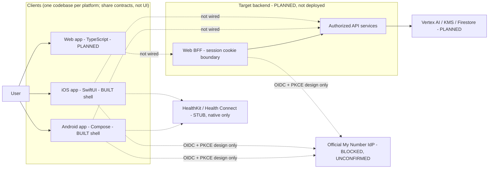
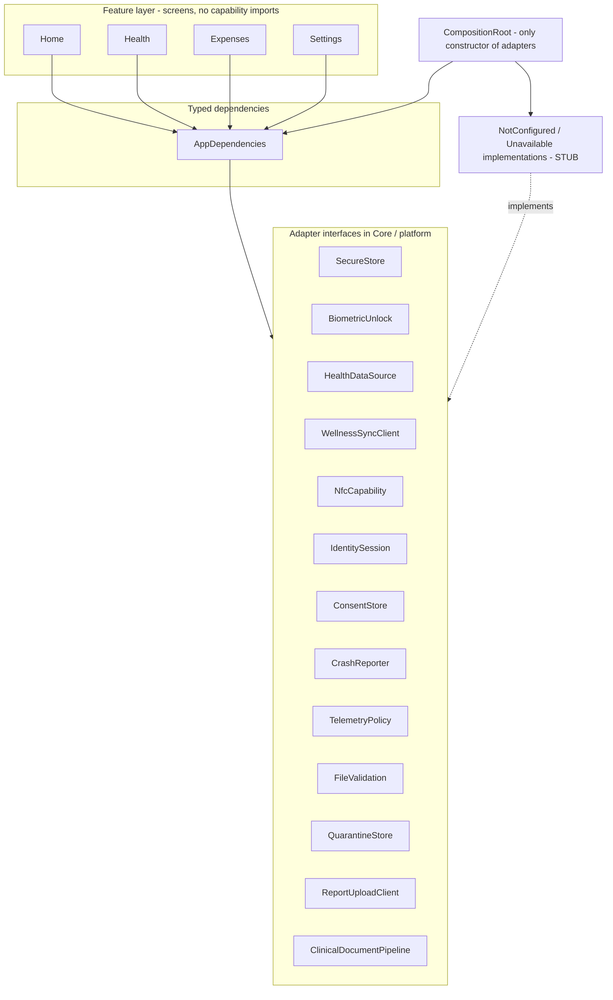
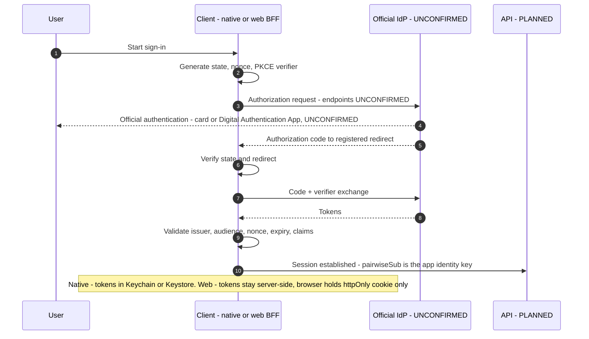
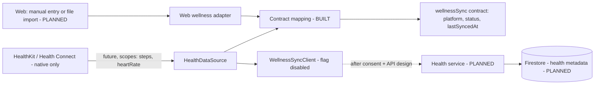
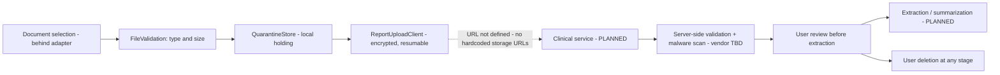
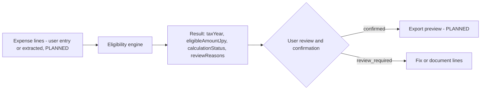
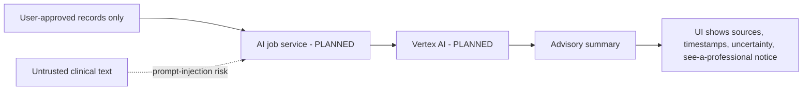
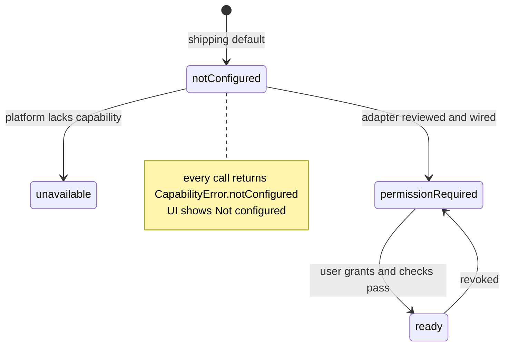

# System architecture

**Status:** Draft (docs-first; pending owner review). **Last updated:** 2026-10-17.
**Scope:** system context, components, data flows, and module/domain design for the **web, iOS and Android** clients and the **target** backend.

This document describes what exists, what is a stub, and what is only planned. It does not invent My Number IdP endpoints, scopes, client IDs, upload URLs or scanner vendors; those are marked **UNCONFIRMED** or **BLOCKED**.

Related: [STACK.md](../STACK.md) · [SPEC.md](../SPEC.md) · [architecture.md](../architecture.md) (staged delivery) · [data-model.md](data-model.md) · [api-contracts.md](api-contracts.md) · [threat-model](../security/threat-model.md) · [ADRs](../adr/README.md)

## Status legend

| Label | Meaning |
|---|---|
| **BUILT** | Code exists in `main` and is covered by CI |
| **STUB** | Interface + `NotConfigured`/`Unavailable` implementation exists; no real capability |
| **PLANNED** | Specified only; no code |
| **BLOCKED** | Cannot start without official provider docs, registration, legal or owner approval |

## 1. Platform reality today

| Component | State |
|---|---|
| `apps/ios` (SwiftUI, iOS 17+) | **BUILT** shell + **STUB** adapters |
| `apps/android` (Kotlin/Compose, minSdk 26) | **BUILT** shell + **STUB** adapters |
| `apps/web` (TypeScript) | **PLANNED** — directory does not exist yet ([ADR-0008](../adr/0008-web-client-stack.md)) |
| `packages/contracts` | **BUILT** (one schema, `portal.json`) |
| `packages/domain` | **BUILT** (Python synthetic fixtures; apps do not import it) |
| `packages/api` | README only (**PLANNED**) |
| Backend (Cloud Run etc.) | **PLANNED**, not deployed, no URLs |
| Identity (My Number IdP) | **BLOCKED** |

## 2. System context



Dotted edges are not implemented. The web client never talks to the IdP from browser JavaScript holding tokens; the BFF is the confidential OIDC relying party (design only, see [ADR-0008](../adr/0008-web-client-stack.md) and the threat model).

## 3. Component diagram (client internals)



The 13 adapter interfaces above are the actual `AppDependencies` fields on iOS (`Core/PlatformAdapters.swift`, `Core/CompositionRoot.swift`) and Android (`platform/PlatformAdapters.kt`, `platform/CompositionRoot.kt`). The web client will mirror the same names where the capability exists on the web (see platform limits in [section 8](#8-platform-limits-matrix)).

## 4. Data-flow diagrams

All flows below are **design**. Nothing is connected today; every adapter on the path returns `notConfigured`.

### 4.1 Identity (BLOCKED — design only)

Issuer, client ID, redirect URI, scopes, claims and any card/NFC step are **UNCONFIRMED** and come only from official provider documentation and approved registration (`.env.example` names: `HEALTH_APP_OIDC_ISSUER`, `HEALTH_APP_OIDC_CLIENT_ID`, `HEALTH_APP_OIDC_REDIRECT_URI`, values never committed).



### 4.2 Wellness

Native: **STUB** (`HealthDataSource`, `WellnessSyncClient`, flag `disabled`). Web: manual entry or file import only; no device sync.



### 4.3 Clinical upload



Stage ids (`selection`, `validation`, `quarantine`, `upload`, `review`, `deletion`) are `ClinicalPipelineStage` in code. No picker, upload SDK or scanner exists (CI forbids them outside adapters).

### 4.4 Expenses



Today the engine is `packages/domain/eligibility.py` (Python, synthetic, **not tax-law guidance**). Native/web ports are PLANNED; the web port is TypeScript.

### 4.5 AI insights (PLANNED)



## 5. Module and domain design

### 5.1 Layering rules (both native clients today, web planned)

1. **Feature layer** (`Features/PortalViews.swift`, `features/PortalScreens.kt`): tab shells Home / Health / Expenses / Settings. Reads `AppDependencies`; never imports a kit.
2. **Core / platform layer** (`Core/*.swift`, `platform/*.kt`): adapter interfaces, `CapabilityStatus` (`notConfigured`, `unavailable`, `ready`, `permissionRequired`), `CapabilityError`, pure mappers, privacy/wellness/clinical baselines.
3. **CompositionRoot**: the only code allowed to construct `NotConfigured*`, `Unavailable*`, `InMemory*` types (enforced by `scripts/check-forbidden-patterns.py`; unit tests exempt).
4. **App entry** (`HealthAppApp.swift`, `MainActivity.kt`): constructs the root once.
5. **Theme / UI-only** on Android: `core/Theme.kt`.

Kit, picker, Keychain/Keystore, biometric, NFC and cloud-storage SDK usage is only permitted in `apps/ios/HealthApp/Core/` and `apps/android/.../platform/`.

### 5.2 Domain concepts

| Domain | Core types (in code) | Status |
|---|---|---|
| Capability | `CapabilityStatus`, `CapabilityError` | BUILT |
| Privacy | `DataCategory`, `ConsentDecision`, `PurposeRegistry`, `SensitiveField`, `LogRedaction` | BUILT |
| Wellness | `WellnessReadScope` (steps, heartRate), `HealthPermissionState`, `WellnessFeatureFlag`, `WellnessContractMapping` | BUILT (mapping) / STUB (kit) |
| Clinical | `ClinicalPipelineStage`, `ClinicalDeclaredType`, `ClinicalFileDescriptor` (metadata only), `ClinicalSurfaceStatus` | BUILT (types) / STUB (pipeline) |
| Expenses | `ExpenseLine`, `EligibilityResult`, `CalculationStatus`, `ReviewReason` (Python) | BUILT fixtures; native port PLANNED |
| Identity | `IdentitySession.pairwiseSubject()` | STUB, BLOCKED |

### 5.3 NotConfigured fail-closed pattern



Only `notConfigured` is reachable today. Transitions to the other states are enabled per stage only after the matching SPEC row is owner-approved.

### 5.4 Web client module design (PLANNED)

```text
apps/web/                      # PLANNED - Next.js + React + TypeScript (ADR-0008)
  src/app/                     # routes: home, health, expenses, settings (feature layer)
  src/core/                    # adapter interfaces, CapabilityStatus, mappers
  src/core/composition-root.ts # only place that constructs adapters
  src/core/adapters/           # NotConfigured* stubs first
  server/                      # BFF route handlers (session cookies, API proxy) - no business logic
packages/contracts             # JSON Schema; TS types generated from it (PLANNED tooling)
packages/domain                # eligibility rules; TS port with shared fixtures (PLANNED)
```

Web adapter set (subset of native): `IdentitySession` (via BFF), `ConsentStore`, `CrashReporter`, `TelemetryPolicy`, `FileValidation`, `ReportUploadClient`, `ClinicalDocumentPipeline`, `WellnessSyncClient` (manual/import only). Not present on web: `HealthDataSource` (kit), `NfcCapability` (always unavailable), `SecureStore` (no browser equivalent for secrets; tokens never client-side), `BiometricUnlock` (WebAuthn only, PLANNED).

## 6. Backend target (PLANNED, not deployed)

Cloud Run services split by purpose — identity, health data, clinical documents, expenses, AI jobs, exports — with Firestore for metadata, Vertex AI, Cloud KMS/CMEK, VPC Service Controls and Cloud Armor. Contract-level descriptions: [api-contracts.md](api-contracts.md). No project IDs, regions, or URLs are defined.

## 7. Cross-cutting policies

- **Fail closed**: unavailable capability is a visible state, never silent success.
- **Pairwise sub only** as app identity key; individual number never a client key.
- **Logging**: event names only via `LogRedaction`; see [privacy-baseline.md](../privacy-baseline.md).
- **Crash/telemetry**: not configured, deny all categories.
- **Synthetic fixtures only** ([ADR-0007](../adr/0007-synthetic-fixtures-only.md)).

## 8. Platform limits matrix

| Capability | iOS | Android | Web |
|---|---|---|---|
| Device health read (HealthKit / Health Connect) | STUB; future steps, heartRate | STUB; same | **No equivalent.** Manual entry or file import only; no device sync |
| Secure storage of secrets | Keychain (STUB) | Keystore (STUB) | **No client-side secret store.** Tokens server-side (BFF), httpOnly + Secure + SameSite cookie; never `localStorage`/`sessionStorage` |
| Local unlock / biometrics | LocalAuthentication (STUB) | BiometricPrompt (STUB) | WebAuthn/passkeys only (PLANNED); no raw biometric access |
| NFC / My Number card reading | CoreNFC via official path (STUB, BLOCKED) | NFC via official path (STUB, BLOCKED) | **Unavailable.** WebNFC is limited and is not used for this product; sign-in uses the official IdP redirect only if the IdP supports a web flow (UNCONFIRMED) |
| Document selection | Picker behind adapter (STUB) | Picker behind adapter (STUB) | Browser file input behind adapter (PLANNED; CI gate to be extended) |
| Crash/telemetry | Not configured | Not configured | Not configured; no third-party scripts |
| Offline cache | Off by default | Off by default | No persistent sensitive cache; no service-worker caching of authenticated responses |
| Distribution | TestFlight / App Store | Play internal / Play | Hosted site (hosting undecided; Cloud Run target) |

## 9. Open questions

1. Does the official IdP support a web redirect flow for relying parties, and with which assurance? (UNCONFIRMED; owner/legal to confirm from official docs.)
2. Is the web client at parity for Clinical upload in MVP, or read-only? (Owner decision.)
3. Hosting for the web app: same Cloud Run project as the BFF, or separate?
