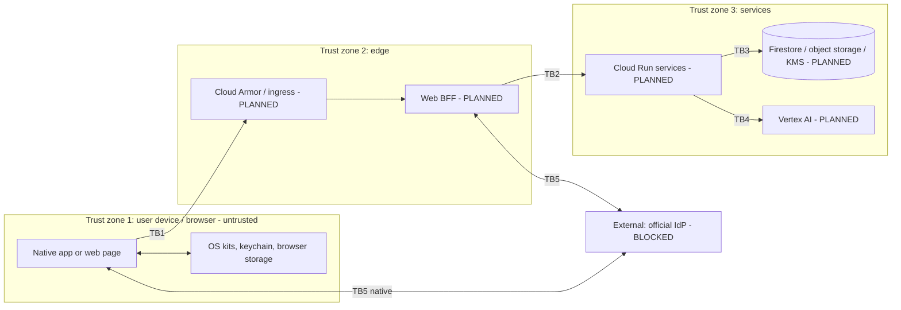

# Threat model

**Status:** Draft for CoE/owner review. **Last updated:** 2026-10-17.
Expands the checklist in [security.md](../security.md). It is a design-stage model: most components are STUB or PLANNED, so many mitigations are *required controls*, not existing code. Built controls are marked **BUILT**.

Related: [system-architecture.md](../architecture/system-architecture.md) · [data-model.md](../architecture/data-model.md) · [api-contracts.md](../architecture/api-contracts.md) · [privacy-baseline.md](../privacy-baseline.md)

## 1. Assets and trust boundaries

| Asset | Class |
|---|---|
| Individual number (never held by clients) | Extremely high |
| `pairwiseSub`, tokens, sessions | Extremely high |
| Clinical documents / extractions | Very high |
| Health measurements, expense data | High |
| AI outputs | Per source |

## 2. STRIDE by component and flow

Legend: S spoofing, T tampering, R repudiation, I information disclosure, D denial of service, E elevation.

### 2.1 Native client (iOS / Android)

| Cat | Threat | Mitigation | Status |
|---|---|---|---|
| S | Malicious app intercepts redirect/auth code | PKCE, registered redirect, state/nonce | PLANNED (Identity blocked) |
| T | Tampered/repackaged app, rooted device | Store distribution, signing, server-side authz, integrity signals TBD | PLANNED; residual |
| R | User denies action | Server audit events (no payload) | PLANNED |
| I | Logs/crash/backups leak data | `LogRedaction`, crash/telemetry disabled, `TelemetryPolicy` denies all | **BUILT** (stubs + helpers) |
| I | Secrets in code/prefs | Forbidden-pattern gate; Keychain/Keystore only after review | **BUILT** gate / STUB storage |
| I | Screenshots, clipboard, app-switcher | Secure-flag/blur policy for sensitive screens | PLANNED |
| D | Local resource abuse | Upload size limits, backoff | PLANNED |
| E | Feature code reaching kits directly | CompositionRoot-only; CI grep | **BUILT** |

### 2.2 Web client (PLANNED) — see also §3

| Cat | Threat | Mitigation |
|---|---|---|
| S | Phishing / lookalike site | HSTS, fixed origin, WebAuthn (origin-bound), user education |
| S | Session fixation / token substitution | Rotate session on login, validate `state`/`nonce` server-side |
| T | XSS alters UI or exfiltrates data | Strict CSP, no inline script, framework escaping, Trusted Types where possible |
| T | CSRF on state-changing requests | SameSite=Strict/Lax cookies, anti-CSRF token, Origin/Fetch-Metadata checks |
| R | Disputed actions | Server audit events |
| I | Token theft from storage | **No tokens in `localStorage`/`sessionStorage`/JS-readable cookies**; BFF with httpOnly+Secure cookies |
| I | Sensitive data in caches/history | `Cache-Control: no-store` on authenticated responses; no service-worker caching of them |
| I | Third-party scripts / analytics | None permitted; no tag managers; SRI for any static third-party asset |
| I | Referrer / URL leakage | No identifiers in URLs; `Referrer-Policy: no-referrer` |
| D | Bot/abuse | Cloud Armor, rate limits |
| E | Clickjacking | `frame-ancestors 'none'` |
| T | Supply chain (npm) | Lockfile, pinned versions, Dependabot, install-script review, provenance checks, minimal deps |

### 2.3 Identity flow (BLOCKED)

| Cat | Threat | Mitigation |
|---|---|---|
| S | Authorization-code interception / injection | PKCE, exact redirect match, one-time state |
| S | Token substitution, mix-up | Validate issuer, audience, nonce, expiry, claims; single issuer config from official docs |
| T | Replay | nonce + short code lifetime |
| I | Individual number exposure | Never requested/stored by client; pairwiseSub only; any exception needs legal review |
| E | Over-broad scopes | Scopes from official docs only; each separately governed; **UNCONFIRMED** |
| — | Unverified claims in docs | This repo contains no endpoints/scopes/client IDs by design |

### 2.4 Wellness

| Cat | Threat | Mitigation |
|---|---|---|
| I | Over-collection of health data | Minimum scopes (`steps`, `heartRate`), purpose-tied consent, no "full dump" |
| T | Spoofed/manual data on web | Mark source (manual/import) in model; never treat as device-verified |
| I | Raw samples logged | `SensitiveField.healthSample` forbidden in logs (**BUILT**) |
| E | Feature flag flipped early | Flag `disabled` in shipping builds until review (**BUILT** default) |

### 2.5 Clinical upload

| Cat | Threat | Mitigation |
|---|---|---|
| T | Malicious file (malware, polyglot) | Client type/size check, server-side validation + malware scan, quarantine; vendor TBD |
| T | Prompt injection in document text | Treat extracted text as untrusted; isolate from instructions; AI output advisory |
| I | Leak via filename/metadata/logs | Never log names/bytes; descriptor is metadata-only (**BUILT**) |
| I | Interception on upload | TLS, encrypted at rest (KMS/CMEK), resumable authorized sessions |
| I | Hardcoded storage URL / public bucket | CI rejects storage URLs/SDKs (**BUILT**); signed, scoped sessions |
| D | Oversized uploads | Size limits, rate limits |
| R/I | Incomplete deletion | User deletion across derived data + tests required |

### 2.6 Backend and data stores (PLANNED)

| Cat | Threat | Mitigation |
|---|---|---|
| S | Service impersonation | Per-service accounts, least privilege, mTLS/IAM |
| E | Cross-user access (IDOR) | Per-user authorization on every call; tests |
| I | Insider access | Access review, audit logs, CMEK, separation of duties |
| I | Data exfiltration | VPC Service Controls, egress limits |
| D | DDoS | Cloud Armor |
| T | Config drift / secrets leak | Managed secrets, IaC review, separate projects per environment |

### 2.7 AI

| Cat | Threat | Mitigation |
|---|---|---|
| T/E | Prompt injection via clinical text | Input isolation, output constraints, no tool access from document content |
| I | Model overreach / diagnosis claims | Advisory-only copy, sources, timestamps, uncertainty, safe fallback |
| I | Training/retention of user data | Vendor terms and settings reviewed by legal before enabling |

### 2.8 Expenses and exports

| Cat | Threat | Mitigation |
|---|---|---|
| T | Wrong eligibility result presented as tax truth | Engine is a synthetic placeholder; `review_required` path; user confirmation before export; tax counsel review |
| I | Export leaks account details | Explicit review step; exclude account numbers |

### 2.9 Supply chain and CI (all clients)

Dependabot enabled; GitHub Actions pinned by SHA (**BUILT**); forbidden-pattern gate for secrets (**BUILT**); workflow permission `contents: read` (**BUILT**). PLANNED: SBOM, dependency audit gate for npm, and provenance checks when `apps/web` lands.

## 3. Web-specific control requirements (normative for apps/web)

1. **Auth architecture:** BFF is the OIDC relying party (design only; IdP details UNCONFIRMED). Browser receives an opaque session in an `HttpOnly; Secure; SameSite` cookie with `__Host-` prefix. No access/refresh/ID tokens reach browser JS.
2. **Storage:** No `localStorage`/`sessionStorage`/IndexedDB for tokens, identity, health, clinical, or expense data. In-memory state only for transient UI.
3. **CSP:** default-src 'self'; script-src with nonces or hashes; no `unsafe-inline`/`unsafe-eval`; `frame-ancestors 'none'`; `object-src 'none'`; `base-uri 'self'`; `form-action 'self'`.
4. **CSRF:** SameSite + per-session anti-CSRF token on non-GET + Origin check; no CORS to third parties.
5. **Local re-entry / step-up:** WebAuthn (passkeys) only after initial identity verification; no custom biometric handling.
6. **Headers:** HSTS (preload decision TBD), `X-Content-Type-Options: nosniff`, `Referrer-Policy: no-referrer`, `Permissions-Policy` denying unused features, COOP/CORP as appropriate.
7. **Third parties:** No analytics, tag managers, fonts/CDNs loaded from third parties for authenticated pages.
8. **Dependencies:** Lockfile committed (pnpm), exact review of install scripts, minimal tree, Dependabot, license check.
9. **Uploads:** File input behind adapter, validated, streamed; never persisted in browser storage.
10. **Errors/logs:** Same `LogRedaction` rule; no PII in client error reporting (reporter not configured).
11. **CI gates to add before web code lands:** extend `scripts/check-forbidden-patterns.py` for web (for example `localStorage`/`sessionStorage` use with sensitive keys, `dangerouslySetInnerHTML`, `eval`, third-party script tags, token-like strings, `NEXT_PUBLIC_`-prefixed secrets, storage URLs, constructors outside the web composition root). PLANNED.

## 4. Privacy considerations (ties to privacy-baseline)

- Data categories and purposes are the `DataCategory`/`PurposeRegistry` set; web must use the same ids.
- Device-boundary principles apply to the browser as an *even less trusted* device: no persistence of sensitive data client-side.
- Consent is recorded per category + purpose; web needs a server-side ledger because it has no secure local store.
- Telemetry and crash reporting remain disabled on all three platforms.
- Individual number: never client-side. Pairwise sub is not a log field.
- Lawful basis, notices, retention periods: **TODO for product/legal**.

## 5. Residual risks

| Risk | Why it remains | Owner |
|---|---|---|
| Compromised or rooted device / compromised browser | Cannot be fully mitigated client-side | Product/CoE |
| Web XSS impact even with httpOnly cookies (actions riding the session) | CSP reduces, not eliminates | CoE |
| Malware scanner efficacy unknown (vendor TBD) | No vendor chosen | Owner |
| AI hallucination / prompt injection | Probabilistic | Product/legal |
| Insider and subprocessor risk | Depends on cloud/vendor agreements | Legal |
| Synthetic eligibility engine misread as tax advice | Placeholder | Tax counsel |
| IdP assurance on web unknown | UNCONFIRMED | Owner/IdP docs |

## 6. Legal / compliance TODOs

- Lawful basis and purpose per data category; consent and withdrawal copy.
- Requirements under applicable Japanese privacy and My Number rules (not cited here).
- Retention and deletion periods; processor/subprocessor agreements; incident notification.
- Whether and how a web relying party may use the official IdP.
- App Store / Play privacy disclosures; health-data store questionnaires.
- Tax counsel review before any expense figure is shown as guidance.

## 7. Review cadence

Update when any component moves from PLANNED/STUB to implementation; mandatory review before Identity, Wellness kit wiring, Clinical upload, AI, and the first web release.
