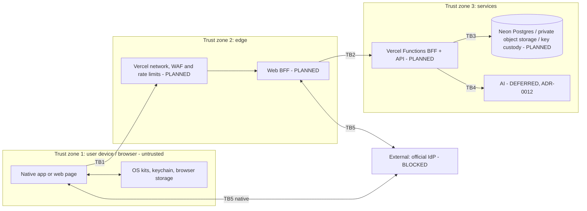
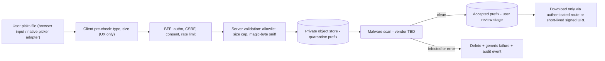

# Threat model

**Status:** Draft for CoE/owner review. **Last updated:** 2026-10-17.
Expands the checklist in [security.md](../security.md). It is a design-stage model: most components are STUB or PLANNED, so many mitigations are *required controls*, not existing code. Built controls are marked **BUILT**.

Related: [system-architecture.md](../architecture/system-architecture.md) · [data-model.md](../architecture/data-model.md) · [api-contracts.md](../architecture/api-contracts.md) · [privacy-baseline.md](../privacy-baseline.md)

## 1. Assets and trust boundaries

| Asset | Class |
|---|---|
| Individual number (never held by clients) | Extremely high |
| `pairwiseSub`, tokens, sessions | Extremely high |
| Clinical documents / extractions | Very high |
| Health measurements, expense data | High |
| AI outputs | Per source |

## 2. STRIDE by component and flow

Legend: S spoofing, T tampering, R repudiation, I information disclosure, D denial of service, E elevation.

### 2.1 Native client (iOS / Android)

| Cat | Threat | Mitigation | Status |
|---|---|---|---|
| S | Malicious app intercepts redirect/auth code | PKCE, registered redirect, state/nonce | PLANNED (Identity blocked) |
| T | Tampered/repackaged app, rooted device | Store distribution, signing, server-side authz, integrity signals TBD | PLANNED; residual |
| R | User denies action | Server audit events (no payload) | PLANNED |
| I | Logs/crash/backups leak data | `LogRedaction`, crash/telemetry disabled, `TelemetryPolicy` denies all | **BUILT** (stubs + helpers) |
| I | Secrets in code/prefs | Forbidden-pattern gate; Keychain/Keystore only after review | **BUILT** gate / STUB storage |
| I | Screenshots, clipboard, app-switcher | Secure-flag/blur policy for sensitive screens | PLANNED |
| D | Local resource abuse | Upload size limits, backoff | PLANNED |
| E | Feature code reaching kits directly | CompositionRoot-only; CI grep | **BUILT** |

### 2.2 Web client (PLANNED) — see also §3

| Cat | Threat | Mitigation |
|---|---|---|
| S | Phishing / lookalike site | HSTS, fixed origin, WebAuthn (origin-bound), user education |
| S | Session fixation / token substitution | Rotate session on login, validate `state`/`nonce` server-side |
| T | XSS alters UI or exfiltrates data | Strict CSP, no inline script, framework escaping, Trusted Types where possible |
| T | CSRF on state-changing requests | SameSite=Strict/Lax cookies, anti-CSRF token, Origin/Fetch-Metadata checks |
| R | Disputed actions | Server audit events |
| I | Token theft from storage | **No tokens in `localStorage`/`sessionStorage`/JS-readable cookies**; BFF with httpOnly+Secure cookies |
| I | Sensitive data in caches/history | `Cache-Control: no-store` on authenticated responses; no service-worker caching of them |
| I | Third-party scripts / analytics | None permitted; no tag managers; SRI for any static third-party asset |
| I | Referrer / URL leakage | No identifiers in URLs; `Referrer-Policy: no-referrer` |
| D | Bot/abuse | Rate limits per IP/account; Vercel WAF rules (plan limits apply: Hobby allows few custom rules, UNVERIFIED for paid tiers) |
| E | Clickjacking | `frame-ancestors 'none'` |
| T | Supply chain (npm) | Lockfile, pinned versions, Dependabot, install-script review, provenance checks, minimal deps |

### 2.3 Identity flow (BLOCKED)

| Cat | Threat | Mitigation |
|---|---|---|
| S | Authorization-code interception / injection | PKCE, exact redirect match, one-time state |
| S | Token substitution, mix-up | Validate issuer, audience, nonce, expiry, claims; single issuer config from official docs |
| T | Replay | nonce + short code lifetime |
| I | Individual number exposure | Never requested/stored by client; pairwiseSub only; any exception needs legal review |
| E | Over-broad scopes | Scopes from official docs only; each separately governed; **UNCONFIRMED** |
| — | Unverified claims in docs | This repo contains no endpoints/scopes/client IDs by design |

#### 2.3b Web fallback auth ([ADR-0010](../adr/0010-web-auth-strategy.md); PLANNED, only if the official IdP web flow is unavailable or not free)

| Cat | Threat | Mitigation |
|---|---|---|
| S | Fallback session mistaken for My Number identity | UI/API carry `authMethod`; identity-gated features disabled; copy never claims My Number verification (legal guardrail) |
| S | Passkey ceremony abuse, wrong origin/RP ID | Pin RP ID/origin to production domain; user verification required; challenge single-use, short-lived, bound to session; verify sign counter behavior |
| S | Email OTP brute force / enumeration | Hashed single-use codes, short expiry, attempt caps, per-IP and per-account rate limits, uniform responses, no account-existence leak |
| S | Mailbox takeover / phishing of OTP | OTP is last-resort; prefer passkeys; notify on new sign-in; step-up for sensitive actions |
| E | Account recovery abuse | Recovery requires second signal or cooling-off; audit events (design TBD) |
| I | Provider sub-processor sees emails | Email provider is a legal/cost review item |

### 2.4 Wellness

| Cat | Threat | Mitigation |
|---|---|---|
| I | Over-collection of health data | Minimum scopes (`steps`, `heartRate`), purpose-tied consent, no "full dump" |
| T | Spoofed/manual data on web | Mark source (manual/import) in model; never treat as device-verified |
| I | Raw samples logged | `SensitiveField.healthSample` forbidden in logs (**BUILT**) |
| E | Feature flag flipped early | Flag `disabled` in shipping builds until review (**BUILT** default) |

### 2.5 Clinical upload (web and native; in MVP scope, fail closed until security review)

| Cat | Threat | Mitigation |
|---|---|---|
| T | Malicious file (malware, polyglot, archive bomb, active content in PDF/SVG/HTML) | Server-side allowlist of types (list TBD, SPEC Q4); magic-byte sniffing, not `Content-Type` or extension; reject archives, SVG, HTML, scripts and Office macros; malware scan with **fail-closed** result (scan error means not accepted); files stay in **quarantine** and unreadable by other services until clean; vendor TBD |
| T | Type/size spoofing | Declared values are advisory; server enforces a hard size cap while streaming and aborts on overflow; per-account and per-day quotas |
| T | Path traversal / key guessing | Filenames never used in storage keys; random keys; original name stored only as encrypted metadata or dropped |
| T | Prompt injection in document text | No AI in MVP ([ADR-0012](../adr/0012-ai-deferred.md)); if reopened, treat extracted text as untrusted |
| I | Public exposure of files | **Private store only; no public URLs at any stage**; web CI gate rejects `access: public` and hardcoded storage hosts; access via authenticated route handler or signed URL (short expiry, single object, GET only) |
| I | Leaky signed URLs (referrer, logs, history, shared links) | Minutes-long expiry, `Referrer-Policy: no-referrer`, never logged, never put in query strings we store; prefer streaming through the BFF with `Cache-Control: private, no-store` (a CDN cache can serve private content to others if misconfigured) |
| I | Content sniffing/XSS when viewing uploads | `X-Content-Type-Options: nosniff`, `Content-Disposition: attachment` or sandboxed viewer on a separate origin, no inline rendering of user HTML/SVG |
| I | Leak via filename/metadata/logs | Never log names/bytes; descriptor is metadata-only (**BUILT**) |
| I | Interception / at-rest exposure | TLS; provider encryption plus app-level envelope encryption for document keys/metadata ([data-model §8](../architecture/data-model.md)) |
| I | Hardcoded storage URL / SDK in features | CI rejects storage URLs and SDKs outside adapters (native **BUILT**; web gate in `scripts/check-web-patterns.py`) |
| I | Preview deployments touching real files | Preview/dev use separate store and credentials, synthetic files only ([hosting-and-compliance](../architecture/hosting-and-compliance.md)) |
| D | Oversized or flood uploads, scanner exhaustion | Size limits, rate limits, queue with back-pressure, serverless function body/duration limits considered at design time (limits not verified here) |
| E | IDOR on document ids | Every read/delete checks owner; random ids; tests |
| R/I | Incomplete deletion | Delete object, row, derived data; backup/PITR retention window documented; user deletion tests required |
| R | Disputed upload | Audit event (metadata only: account, document id, stage, time) |

While `ClinicalDocumentPipeline`/`ReportUploadClient` are `NotConfigured`, no picker, request or object exists (**BUILT** on native; web adapter **PLANNED** with the same default).

### 2.6 Backend and data stores (PLANNED; Vercel + Neon, [ADR-0011](../adr/0011-hosting-vercel-neon.md))

| Cat | Threat | Mitigation |
|---|---|---|
| S | Service impersonation / stolen credentials | Short-lived platform OIDC credentials where offered (Blob SDK on Vercel); DB credentials only in Production-scoped secrets; rotation; least-privilege DB roles (app vs migration) |
| E | Cross-user access (IDOR) | Per-user authorization on every call; row ownership checks; tests |
| I | Insider / vendor access | Sub-processor review (legal), access review, audit logs, app-level envelope encryption so provider-side access does not reveal sensitive fields, separation of duties |
| I | Provider-managed keys only (no customer-managed keys found) | Application-level field encryption; master-key custody decision open ([hosting-and-compliance §5](../architecture/hosting-and-compliance.md)) |
| I | Data exfiltration | Egress review, DB IP allow/Private Networking on Neon Scale, no wildcard credentials, rate limits |
| I | **Logs leak PII** (runtime logs 1 hour to 30 days by plan; build logs kept indefinitely) | Event-name-only logging; no bodies, ids, filenames; no log drains without legal check; never echo env vars |
| I | **Preview deployments with real data or prod credentials** | Preview/Development scopes hold only synthetic-data credentials; Deployment Protection on; no production branch/restore into previews; CI check that no production secret name is Preview-scoped (manual until automated) |
| I | Backups/PITR retain deleted data | Documented windows (Neon: 6 hours Free, up to 7/30 days paid); deletion policy accounts for them; restore drills |
| D | DDoS / abuse | Vercel platform DDoS mitigation (on by default per docs), rate limits, WAF rules per plan; cost-exhaustion alerts and spend limits |
| D | Free-tier suspension, no SLA, cold starts | Free tiers synthetic-only; paid plan with SLA before real data |
| T | Config drift / secrets leak | Managed secrets (Secret-type env vars), IaC or documented config, separate projects per environment, secret scanning in CI |
| T | SQL injection / unsafe queries | Parameterized queries only, typed query layer, DB role without DDL at runtime |
| I | Cross-border processing (Singapore DB, global edge) | Legal review item; minimize data in transit; encryption |

### 2.7 AI (DEFERRED to post-MVP, [ADR-0012](../adr/0012-ai-deferred.md); applies only if reopened)

| Cat | Threat | Mitigation |
|---|---|---|
| T/E | Prompt injection via clinical text | Input isolation, output constraints, no tool access from document content |
| I | Model overreach / diagnosis claims | Advisory-only copy, sources, timestamps, uncertainty, safe fallback |
| I | Training/retention of user data | Vendor terms and settings reviewed by legal before enabling |

### 2.8 Expenses and exports

| Cat | Threat | Mitigation |
|---|---|---|
| T | Wrong eligibility result presented as tax truth | Engine is a synthetic placeholder; `review_required` path; user confirmation before export; tax counsel review |
| I | Export leaks account details | Explicit review step; exclude account numbers |

### 2.9 Supply chain and CI (all clients)

Dependabot enabled; GitHub Actions pinned by SHA (**BUILT**); forbidden-pattern gate for secrets (**BUILT**); workflow permission `contents: read` (**BUILT**). PLANNED: SBOM, dependency audit gate for npm, and provenance checks when `apps/web` lands.

## 3. Web-specific control requirements (normative for apps/web)

1. **Auth architecture:** BFF owns the session. Method per [ADR-0010](../adr/0010-web-auth-strategy.md): official IdP web flow (OIDC relying party, design only; IdP details UNCONFIRMED) if free and supported, else passkeys, else email OTP; a fallback is never described as My Number identity. Browser receives an opaque session in an `HttpOnly; Secure; SameSite` cookie with `__Host-` prefix. No access/refresh/ID tokens reach browser JS.
2. **Storage:** No `localStorage`/`sessionStorage`/IndexedDB for tokens, identity, health, clinical, or expense data. In-memory state only for transient UI.
3. **CSP:** default-src 'self'; script-src with nonces or hashes; no `unsafe-inline`/`unsafe-eval`; `frame-ancestors 'none'`; `object-src 'none'`; `base-uri 'self'`; `form-action 'self'`.
4. **CSRF:** SameSite + per-session anti-CSRF token on non-GET + Origin check; no CORS to third parties.
5. **Local re-entry / step-up:** WebAuthn (passkeys) only after initial identity verification; no custom biometric handling.
6. **Headers:** HSTS (preload decision TBD), `X-Content-Type-Options: nosniff`, `Referrer-Policy: no-referrer`, `Permissions-Policy` denying unused features, COOP/CORP as appropriate.
7. **Third parties:** No analytics, tag managers, fonts/CDNs loaded from third parties for authenticated pages.
8. **Dependencies:** Lockfile committed (pnpm), exact review of install scripts, minimal tree, Dependabot, license check.
9. **Uploads (in MVP, fail closed until review):** File input behind adapter; client checks are UX only; server allowlist, magic-byte sniffing, size cap, quarantine and malware scan before acceptance; private object storage only, no public URLs, short-lived signed URLs or authenticated streaming with `no-store`; never persisted in browser storage. See §2.5.
10. **Errors/logs:** Same `LogRedaction` rule; no PII in client error reporting (reporter not configured).
11. **CI gates (BUILT, conditional until `apps/web` exists):** `.github/workflows/web-ci.yml` runs `scripts/check-web-patterns.py`, which fails on `localStorage`/`sessionStorage`/IndexedDB use, `document.cookie`, `dangerouslySetInnerHTML`/`innerHTML`/`eval`, third-party script tags, secret-like `NEXT_PUBLIC_` names, token-like strings, database URLs with credentials, public blob access or hardcoded storage hosts, auth/db/storage/email SDK imports outside `apps/web/src/core/`, stub adapter constructors outside `composition-root.ts`, committed `.env*` files, unpinned or git dependencies, install-lifecycle scripts, and a missing lockfile. The workflow also runs `pnpm install --frozen-lockfile --ignore-scripts`, `pnpm audit --prod --audit-level=high`, typecheck, lint, test and build once the app exists. Regex gates are tripwires, not proof.

## 4. Privacy considerations (ties to privacy-baseline)

- Data categories and purposes are the `DataCategory`/`PurposeRegistry` set; web must use the same ids.
- Device-boundary principles apply to the browser as an *even less trusted* device: no persistence of sensitive data client-side.
- Consent is recorded per category + purpose; web needs a server-side ledger because it has no secure local store.
- Telemetry and crash reporting remain disabled on all three platforms.
- Individual number: never client-side. Pairwise sub is not a log field.
- Lawful basis, notices, retention periods: **TODO for product/legal**.

## 5. Residual risks

| Risk | Why it remains | Owner |
|---|---|---|
| Compromised or rooted device / compromised browser | Cannot be fully mitigated client-side | Product/CoE |
| Web XSS impact even with httpOnly cookies (actions riding the session) | CSP reduces, not eliminates | CoE |
| Malware scanner efficacy unknown (vendor TBD); web upload is in MVP | No vendor chosen | Owner |
| Health data on Vercel/Neon: cross-border (Singapore DB), no customer-managed keys found, free-tier limits, log retention | Owner chose hosting; see [hosting-and-compliance](../architecture/hosting-and-compliance.md) | Owner/Legal/CoE |
| Fallback auth is weaker than card-based My Number sign-in | Browsers cannot read the card | Owner/Legal |
| AI hallucination / prompt injection | Probabilistic | Product/legal |
| Insider and subprocessor risk | Depends on cloud/vendor agreements | Legal |
| Synthetic eligibility engine misread as tax advice | Placeholder | Tax counsel |
| IdP assurance on web unknown | UNCONFIRMED | Owner/IdP docs |

## 6. Legal / compliance TODOs

- Lawful basis and purpose per data category; consent and withdrawal copy.
- Requirements under applicable Japanese privacy and My Number rules (not cited here).
- Retention and deletion periods; processor/subprocessor agreements; incident notification.
- Whether and how a web relying party may use the official IdP, and whether non-My-Number fallback accounts are acceptable.
- APPI special care-required treatment, cross-border transfer, sub-processors, My Number Act storage limits: full list in [hosting-and-compliance §4](../architecture/hosting-and-compliance.md).
- App Store / Play privacy disclosures; health-data store questionnaires.
- Tax counsel review before any expense figure is shown as guidance.

## 7. Review cadence

Update when any component moves from PLANNED/STUB to implementation; mandatory review before Identity, Wellness kit wiring, Clinical upload, AI, and the first web release.
