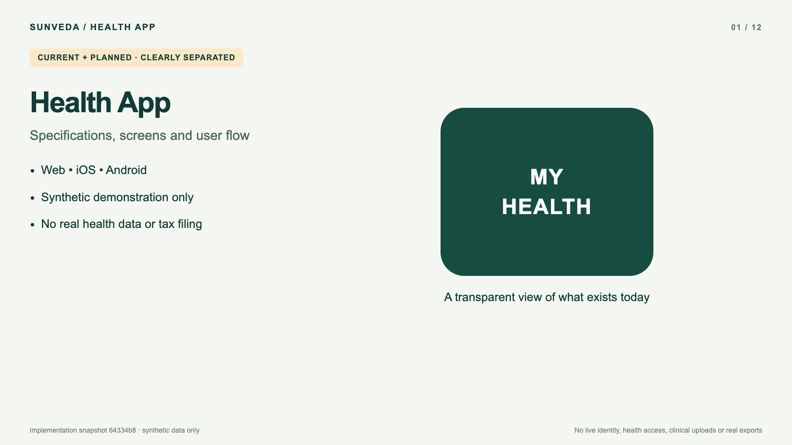

# Health App video walkthrough

[Watch or download the narrated MP4](health-app-walkthrough.mp4) · [Transcript](transcript.md) · [English subtitles](health-app-walkthrough.srt)

A 3 minute 39 second overview of the specification, all four main screens, the current synthetic expense review and the planned user journey. English synthesized narration, on-screen explanations and an embedded English subtitle track. MP4/H.264 video, AAC audio, 1600 × 900. GitHub may offer download instead of an inline player; the downloaded file plays in a standard browser/video player.

## What is shown

- **Actual local web captures:** expense entry, calculation details, review-required example, acknowledgment/export placeholder and phone-width responsive web.
- **Illustrative native layouts:** Home, Health and Settings, derived from existing native source and `docs/mvp-screens.md`. These are labeled in both image and narration; they are not simulator or device captures, and exact native appearance is unverified.
- **Planned flow:** reviewed identity → consent → approved health access or clinical upload → record review → reviewed expense calculation → separate export confirmation. These integrations are not implemented or verified.
- **Architecture:** approved Next.js/BFF direction from merged PR #28, native SwiftUI and Kotlin/Compose; Vercel/Neon are hosting targets, and AI is deferred.

The responsive phone-width capture is **web, not native iOS or Android**. There is no separate Clinical tab. Current native Home/Health/Settings show Not configured capabilities, not real patient records. Web currently provides the expense demonstration, not a full four-tab portal.

## Provenance and boundaries

Captured from local implementation commit `64334b82ccb48d39de3457334145960a29dcde9f`, based on main `368e1ad` (PR #28 architecture and PR #15 Android upgrade). That implementation commit remains local in its separate branch; this documentation-only branch publishes the video and supporting files, not the implementation. Prior Vite draft PR #24 is untouched.

Sources: `docs/mvp-screens.md`, `docs/adr/0008-web-client-stack.md`, `docs/adr/0009-web-session-and-token-handling.md`, `docs/adr/0011-hosting-vercel-neon.md`, native `PortalViews.swift` / `PortalScreens.kt`, and the local synthetic expense implementation.

Synthetic fixture data only. No personal identity, real health data, documents, credentials or user accounts are shown. No live My Number, device health, clinical upload or real export is enabled. This is not clinical readiness, tax guidance or a deployment. Native builds and device UI require configured Xcode and Android runners; only Swift syntax/model parity was checked locally.

## Verification

The completed file was fully decoded by FFmpeg without errors and inspected with FFprobe. Local Chrome playback was checked for advancing video frames and seeking to a later chapter; it contains H.264 video, AAC narration and an English subtitle track. Representative actual and illustrative frames were visually inspected. See `chapters.json` for timings and `SHA256SUMS` for integrity.

No application source was changed by this video branch. No merge or deployment was performed.
